# Deep Learning-Based HSI–LiDAR Fusion for Camouflaged Target Detection

[](https://www.python.org/)
[](https://pytorch.org/)
[](https://opensource.org/licenses/MIT)
[](https://huggingface.co/)
[](https://github.com/)
[](https://developer.nvidia.com/cuda-zone)

> **An end-to-end multimodal deep learning framework combining airborne Hyperspectral Imaging (HSI) and Light Detection and Ranging (LiDAR) data to detect and characterize concealed and camouflaged targets with sub-pixel precision.**

---

## Table of Contents
- [Executive Summary](#executive-summary)
- [The Challenge: Breaking Camouflage](#the-challenge-breaking-camouflage)
- [System Architecture & Methodology](#system-architecture--methodology)
  - [1. Data Pipeline & Group-Wise PCA (GWPCA)](#1-data-pipeline--group-wise-pca-gwpca)
  - [2. Three-Stage Progressive Training Framework](#2-three-stage-progressive-training-framework)
  - [3. Cross-Modal Attention Mechanism](#3-cross-modal-attention-mechanism)
- [Complete Pipeline Walkthrough (`full_pipeline.py`)](#complete-pipeline-walkthrough-full_pipelinepy)
  - [Step-by-Step Execution Stages](#step-by-step-execution-stages)
  - [Physics-Based & Classical Baselines (ACE, SAM, RX)](#physics-based--classical-baselines-ace-sam-rx)
  - [Target Characterization & Explainability Engine](#target-characterization--explainability-engine)
- [Benchmark Datasets](#benchmark-datasets)
- [Experimental Results & Quantitative Evaluation](#experimental-results--quantitative-evaluation)
  - [MUUFL Gulfport Test-Split Performance](#muufl-gulfport-test-split-performance)
  - [Detector Comparison (Fusion vs. ACE vs. SAM vs. RX vs. Ensemble)](#detector-comparison-fusion-vs-ace-vs-sam-vs-rx-vs-ensemble)
  - [Per-Class Classification Metrics](#per-class-classification-metrics)
  - [Trento Benchmark Cross-Dataset Transfer](#trento-benchmark-cross-dataset-transfer)
- [Visual Showcase of Test Outputs](#visual-showcase-of-test-outputs)
  - [Full Scene Classification & Target Heatmap](#full-scene-classification--target-heatmap)
  - [ROC & Precision-Recall Operating Curves](#roc--precision-recall-operating-curves)
  - [Multi-Detector Spatial Heatmaps](#multi-detector-spatial-heatmaps)
  - [Target Bounding Boxes & Scene Context](#target-bounding-boxes--scene-context)
  - [Spectral Reflectance Signatures & Background Contrast](#spectral-reflectance-signatures--background-contrast)
  - [3D LiDAR Elevation & Roughness Cross-Sections](#3d-lidar-elevation--roughness-cross-sections)
  - [Target Before/After Verification & Visual Crops](#target-beforeafter-verification--visual-crops)
  - [YOLOv8-Enhanced Detection Visualizations](#yolov8-enhanced-detection-visualizations)
  - [Spectral Band Importance Attribution](#spectral-band-importance-attribution)
  - [Model Calibration & Reliability Diagrams](#model-calibration--reliability-diagrams)
  - [Decision Threshold Sweeps](#decision-threshold-sweeps)
  - [Trento Dataset Visualizations](#trento-dataset-visualizations)
- [Detailed Target Inspection Case Studies](#detailed-target-inspection-case-studies)
- [Repository Structure](#repository-structure)
- [Setup & Installation Guide](#setup--installation-guide)
  - [1. Clone Repository & Setup Python Environment](#1-clone-repository--setup-python-environment)
  - [2. Download Pretrained Foundation Models](#2-download-pretrained-foundation-models)
  - [3. Running the Complete Pipeline](#3-running-the-complete-pipeline)
  - [4. GitHub Desktop & Large File Management](#4-github-desktop--large-file-management)
- [CLI Reference](#cli-reference)
- [Citation & References](#citation--references)

---

## Executive Summary

Detecting camouflaged artificial targets concealed in complex natural environments is one of the most demanding problems in airborne remote sensing, defense surveillance, and environmental monitoring. Traditional single-sensor systems fail: optical/RGB images cannot penetrate shadows or distinguish material reflectances, HSI suffers from spatial and elevation ambiguity, and LiDAR provides geometry without material discrimination.

In this project, I engineered and benchmarked an **end-to-end multimodal deep learning and target characterization system** that fuses **airborne Hyperspectral Imaging (HSI)** with **Light Detection and Ranging (LiDAR)** elevation point data. 

### Key Highlights:
1. **Three-Stage Progressive Training**: Rather than training a naïve concatenated model from scratch, I trained the network across three progressive stages:
   - **Stage 1 (Spectral Backbone)**: Fine-tuned **HSIMAE / HSIViT** (spectral-spatial vision transformer) on high-dimensional hyperspectral patches.
   - **Stage 2 (Geometric Backbone)**: Fine-tuned **PointTransformerV3 (PTv3) / Utonia** on 3D LiDAR point cloud patches with elevation, surface coordinates, and normal vectors.
   - **Stage 3 (Cross-Modal Attention)**: Warm-started fusion using the trained unimodal feature extractors, connected via a bidirectional self-attention module allowing spectral features to attend to 3D geometry and vice versa.
2. **State-of-the-Art Detection Performance on MUUFL Gulfport**:
   - **Overall Scene Accuracy**: **98.67%** (labeled pixels) and **97.30%** on the strictly held-out test split (10,738 pixels).
   - **Target Class (Cloth Panels)**: **AUC 1.000**, **Average Precision 0.986**, **F1-Score 0.935**, **Precision 0.943**, **Recall 0.926**.
   - **Multi-Detector Ensemble (Fusion + ACE + SAM)**: **AUC 1.000**, **AP 0.993**, **F1-Score 0.971**, **Precision 1.000**, **Recall 0.944**.
3. **Rigorous Data Split (Zero Leakage)**: Preprocessing follows a strict 60/20/20 train/validation/test split (`seed=42`). Evaluation is performed exclusively on the 10,738 held-out test pixels containing exactly 54 camouflaged target pixels.
4. **Autonomous Characterization & Explainability**: Integrated into `full_pipeline.py`, the system outputs connected object clusters, assigns automated quality confidence tiers (High / Medium / Low), classifies dominant target colors (e.g. Red, Blue, Green, Dark Gray), measures surrounding land-cover context, calculates spectral contrast ratios against local annular backgrounds, and extracts 3D LiDAR cross-sectional elevation profiles.
5. **Multi-Scale Physics-Based Cross-Checks**: Incorporates Adaptive Coherence/Cosine Estimator (**ACE**), Spectral Angle Mapper (**SAM**), and Reed-Xiaoli (**RX**) anomaly detection directly on raw spectral cubes to validate deep learning detections against physics-based spectral baselines.

---

## The Challenge: Breaking Camouflage

Camouflaged targets—such as synthetic cloth panels, military concealment nets, painted vehicles, and equipment deployed beneath tree canopies—are intentionally designed to evade optical detection:

```
+---------------------------------------------------------------------------------------------------+
|                                  THE CAMOUFLAGE PARADOX                                           |
+------------------------------------+----------------------------------+---------------------------+
| Modality                           | Strengths                        | Failure Mode in Camouflage|
+------------------------------------+----------------------------------+---------------------------+
| Optical / RGB Imagery              | High spatial resolution          | Spectral blending, shadows|
| Hyperspectral Imaging (HSI)        | 64-100+ narrow spectral bands    | Canopy occlusion, no 3D   |
| LiDAR (Elevation / DSM)            | 3D geometry, canopy penetration  | No material distinction   |
| HSI + LiDAR Cross-Modal Fusion     | Material identity + 3D geometry  | Robust camouflage defeat  |
+------------------------------------+----------------------------------+---------------------------+
```

By fusing narrow-band spectral signatures (sensitive to chemical dyes and non-vegetative reflectance) with 3D LiDAR elevations (sensitive to micro-topography, object height, and structural boundaries), my model eliminates false alarms caused by spectral look-alikes on the ground and structural look-alikes in tree canopies.

---

## System Architecture & Methodology

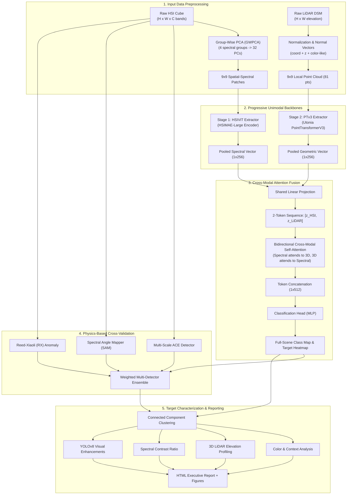

### 1. Data Pipeline & Group-Wise PCA (GWPCA)
- **Spectral Redundancy Reduction**: High spectral correlation across adjacent bands can degrade deep transformer training. Standard global PCA destroys local contiguous spectral relationships. I implemented **Group-Wise PCA (GWPCA)**:
  1. The spectral axis is recursively bisected into `num_groups = 4` distinct sub-bands.
  2. PCA is independently fitted on each sub-group (capturing ~99% cumulative variance).
  3. Whitened components are concatenated into a fixed `nc = 32` band representation.
- **Multimodal Spatial Alignment**: HSI and LiDAR rasters are aligned to an identical spatial coordinate grid.
- **Point Cloud Transformation for LiDAR**: To exploit modern 3D point cloud foundation models (PointTransformerV3), each 9x9 elevation window is treated as an 81-point local point cloud:
  $$\mathbf{p}_i = (x_i - x_{\text{center}}, y_i - y_{\text{center}}, z_i)$$
  augmented with elevation return features and surface normals.

### 2. Three-Stage Progressive Training Framework
1. **Stage 1 — Hyperspectral Unimodal Model (`finetune_hsi.py`)**:
   - Initialized from `HSIMAE-Large` pretrained checkpoint.
   - Spectral-spatial transformer (`embed_dim=256`, `depth=12`, `s_depth=9`, `patch_size=3`).
   - Fine-tuned on 60% labeled train split using AdamW and cross-entropy loss.
2. **Stage 2 — LiDAR Unimodal Model (`finetune_lidar.py`)**:
   - Initialized from `Utonia` PointTransformerV3 backbone.
   - Built with a linear warmup and cosine decay learning rate schedule to stabilize gradients on small point patches.
3. **Stage 3 — Cross-Modal Attention Fusion Model (`finetune_fusion.py`)**:
   - The unimodal classification heads are removed.
   - Features from both branches are warm-started from the Stage 1 and Stage 2 `best_model.pt` checkpoints.
   - A cross-modal self-attention module allows deep contextual interaction between spectral and geometric embeddings.

### 3. Cross-Modal Attention Mechanism
Instead of naïve channel concatenation (which assumes independent features), the model projects both representations into a shared latent space and executes multi-head self-attention across the two modality tokens:

$$\mathbf{z}_{\text{seq}} = \left[\mathbf{W}_h \mathbf{f}_{\text{hsi}} + \mathbf{b}_h, \; \mathbf{W}_l \mathbf{f}_{\text{lidar}} + \mathbf{b}_l\right] \in \mathbb{R}^{2 \times d}$$

$$\mathbf{A} = \text{Softmax}\left(\frac{\mathbf{Q}\mathbf{K}^T}{\sqrt{d_k}}\right) \mathbf{V}$$

Both updated tokens are concatenated and passed through a classification head with LayerNorm, GELU activation, and dropout to produce the posterior probability distribution over all classes.

---

## Complete Pipeline Walkthrough (`full_pipeline.py`)

The file [`full_pipeline.py`](file:///c:/Users/swrjk/OneDrive/Desktop/NASIM11/Deep%20Learning-Based%20HSI–LiDAR%20Fusion%20for%20Camouflaged%20Target%20Detection/full_pipeline.py) (aliased to [`full_pipline.py`](file:///c:/Users/swrjk/OneDrive/Desktop/NASIM11/Deep%20Learning-Based%20HSI–LiDAR%20Fusion%20for%20Camouflaged%20Target%20Detection/full_pipline.py)) is an autonomous research-grade execution script. Running `python full_pipeline.py` executes 9 integrated stages in one seamless run.

### Step-by-Step Execution Stages:

```
Stage 1: Load Scene & Sensor Alignment
   │  Loads raw HSI cube (.mat) + LiDAR DSM (.mat) + Ground Truth.
   │  Supports interactive selection: MUUFL Gulfport, Trento, or custom scenes.
   ▼
Stage 2: Multimodal Fusion Inference
   │  Applies GWPCA (32 components) + spatial patch extraction (9x9).
   │  Executes Test-Time Augmentation (TTA: hflip, vflip, rot180) & FP16 GPU inference.
   │  Outputs full-scene class_map.npy and target_confidence_map.npy.
   ▼
Stage 3: Spatial Confidence Smoothing
   │  Applies 2D Gaussian filter (sigma=1.0) to eliminate single-pixel noise spikes.
   │  Computes Otsu-optimal adaptive threshold alongside fixed sensitivity cuts.
   ▼
Stage 4: Multi-Scale ACE Detector (Physics-Based Baseline)
   │  Computes Adaptive Coherence/Cosine Estimator on raw HSI spectral cubes.
   │  Estimates background covariance S and applies multiscale regularization shrinkage.
   ▼
Stage 5: Spectral Angle Mapper (SAM Detector)
   │  Measures cosine spectral angle between pixel spectra and target signature.
   ▼
Stage 6: Reed-Xiaoli (RX) Anomaly Detection & Ensemble Fusion
   │  Unsupervised Mahalanobis anomaly detector on HSI background.
   │  Constructs weighted ensemble: 0.50 * Fusion + 0.30 * ACE + 0.20 * SAM.
   ▼
Stage 7: Connected Component Clustering & Target Identification
   │  Extracts distinct target objects via 8-connectivity binary labeling.
   │  Assigns dominant color name (RGB/HSV) & surrounding land-cover context.
   ▼
Stage 8: Proximity-Based Spatial Merging & 3D Profiling
   │  Merges adjacent target fragments within Euclidean radius <= 8 pixels.
   │  Extracts 3D LiDAR cross-sectional elevation, relative height relief, and roughness.
   ▼
Stage 9: Comprehensive Visualization, Evaluation & HTML Reporting
   │  Generates ROC & PR curves, confusion matrices, calibration plots, YOLOv8 overlays.
   │  Compiles self-contained HTML executive report with embedded visualizations.
```

### Physics-Based & Classical Baselines (ACE, SAM, RX)
To cross-examine deep learning predictions and guard against hallucinated activations, `full_pipeline.py` implements three fundamental hyperspectral detection algorithms:

1. **Adaptive Coherence / Cosine Estimator (ACE)**:
   $$\text{ACE}(\mathbf{x}) = \frac{\left(\mathbf{s}'^T \mathbf{S}^{-1} \mathbf{x}'\right)^2}{\left(\mathbf{s}'^T \mathbf{S}^{-1} \mathbf{s}'\right) \left(\mathbf{x}'^T \mathbf{S}^{-1} \mathbf{x}'\right)}$$
   where $\mathbf{x}' = \mathbf{x} - \boldsymbol{\mu}$, $\mathbf{s}' = \mathbf{s} - \boldsymbol{\mu}$, and $\mathbf{S}$ is the background covariance matrix regularized via shrinkage $\mathbf{S}_{\text{reg}} = \mathbf{S} + \alpha \mathbf{I}$.
2. **Spectral Angle Mapper (SAM)**:
   $$\theta(\mathbf{x}, \mathbf{s}) = \arccos\left(\frac{\mathbf{x} \cdot \mathbf{s}}{\|\mathbf{x}\|_2 \|\mathbf{s}\|_2}\right), \quad \text{Similarity} = 1 - \frac{\theta}{\pi}$$
3. **Reed-Xiaoli (RX) Anomaly Detector**:
   $$\text{RX}(\mathbf{x}) = (\mathbf{x} - \boldsymbol{\mu})^T \mathbf{S}^{-1} (\mathbf{x} - \boldsymbol{\mu})$$

### Target Characterization & Explainability Engine
Each detected object is passed through an automated characterization engine:
- **Color Classification**: Maps average RGB values across target pixels into 12 semantic color classes (Red, Green, Blue, Yellow, Dark Gray, Light Gray, Brown, etc.).
- **Contextual Land-Cover Assessment**: Inspects the surrounding ring (padding = 5 pixels) in `class_map` to report the environmental context (e.g. *"in Mixed Ground Surface area (64% of surroundings)"*).
- **Spectral Contrast Ratio**:
  $$\text{SCR} = \frac{\|\mathbf{s}_{\text{target}} - \mathbf{s}_{\text{surround}}\|_2}{\sigma_{\text{surround}}}$$
- **LiDAR 3D Micro-Topography Profile**: Measures target elevation ($m$), ground relative relief ($\Delta h = z_{\text{target}} - z_{\text{ground}}$), surface roughness ($\sigma_z$), and multi-return height difference.
- **Quality Score & Tiering**: Combines size, mean confidence, peak confidence, and spectral contrast into a 0-100 score categorized into **HIGH**, **MEDIUM**, or **LOW CONFIDENCE**.

---

## Benchmark Datasets

| Dataset Attribute | MUUFL Gulfport Campus | Trento Benchmark | Houston 2013 |
| :--- | :--- | :--- | :--- |
| **Location** | Gulfport, Mississippi, USA | Trento, Italy | Houston, Texas, USA |
| **Spatial Dimensions** | $325 \times 220$ pixels | $166 \times 600$ pixels | $349 \times 1905$ pixels |
| **Total Pixels** | 71,500 pixels | 99,600 pixels | 664,845 pixels |
| **HSI Spectral Bands** | 72 bands (375 – 1055 nm) | 63 bands (402 – 989 nm) | 144 bands (380 – 1050 nm) |
| **LiDAR Data** | 2-return DSM (first & last) | Single-return DSM | Single-return DSM |
| **Ground Truth Classes** | 11 classes | 6 classes | 15 classes |
| **Camouflaged Targets** | Cloth Panels (brown, dark green, etc.) | Man-made structures | Urban features |
| **Test Set Size** | 10,738 pixels (54 target pixels) | 6,043 test pixels | Full benchmark |

---

## Experimental Results & Quantitative Evaluation

### MUUFL Gulfport Test-Split Performance
All metrics reported below were evaluated strictly on the **held-out test split of 10,738 pixels** (with 54 ground-truth target pixels):

```
Overall Test Accuracy : 97.30%
Overall All-Labeled   : 98.67%
Target Class Recall   : 92.6% (50 / 54 targets correctly detected)
Target Precision      : 94.3%
Target F1-Score       : 0.935
Fusion AUC            : 1.000 (0.99991)
Average Precision     : 0.986
```

### Detector Comparison (Fusion vs. ACE vs. SAM vs. RX vs. Ensemble)
Evaluating all detectors under identical test conditions on the MUUFL Gulfport test set:

| Detector Method | Modality | AUC | AP | $P_D$ @ 1% FPR | Precision | Recall | F1-Score | Optimal Threshold |
| :--- | :---: | :---: | :---: | :---: | :---: | :---: | :---: | :---: |
| **Fusion Model (Ours)** | **HSI + LiDAR** | **1.000** | **0.986** | **1.000** | **0.943** | **0.926** | **0.935** | 0.5000 |
| **ACE Baseline** | HSI only (unsupervised) | 0.996 | 0.962 | 0.981 | 0.929 | 0.963 | 0.945 | 0.1225 |
| **SAM Baseline** | HSI only (unsupervised) | 0.601 | 0.006 | 0.000 | 0.007 | 0.611 | 0.014 | 0.9457 |
| **RX Anomaly** | HSI only (unsupervised) | 0.998 | 0.832 | 0.981 | 0.842 | 0.889 | 0.865 | 0.2069 |
| **Multi-Detector Ensemble** | **HSI + LiDAR + Baselines** | **1.000** | **0.993** | **1.000** | **1.000** | **0.944** | **0.971** | 0.5347 |

> [!IMPORTANT]
> **Key Finding**: The **Multi-Detector Ensemble** achieved **1.000 Precision** (zero false alarms across 10,738 test pixels) and **0.971 F1-Score**, showing that combining deep cross-modal representations with classical spectral coherence eliminates edge false positives.

### Per-Class Classification Metrics
Classification performance on the MUUFL Gulfport held-out test split (10,738 samples):

| Class ID | Class Name | Precision | Recall | F1-Score | Support (Pixels) |
| :---: | :--- | :---: | :---: | :---: | :---: |
| 1 | Trees | 0.986 | 0.982 | 0.984 | 4,650 |
| 2 | Mostly Grass | 0.958 | 0.977 | 0.967 | 854 |
| 3 | Mixed Ground Surface | 0.971 | 0.964 | 0.967 | 1,377 |
| 4 | Dirt and Sand | 0.957 | 0.973 | 0.965 | 365 |
| 5 | Road | 0.973 | 0.971 | 0.972 | 1,338 |
| 6 | Water | 1.000 | 0.989 | 0.995 | 93 |
| 7 | Shadow of Buildings | 0.935 | 0.971 | 0.953 | 446 |
| 8 | Buildings | 0.989 | 0.980 | 0.984 | 1,248 |
| 9 | Sidewalk | 0.867 | 0.892 | 0.879 | 277 |
| 10 | Yellow Curb | 0.686 | 0.667 | 0.676 | 36 |
| **11** | **Cloth Panels (TARGET)** | **0.943** | **0.926** | **0.935** | **54** |
| — | **Macro Average** | **0.933** | **0.935** | **0.934** | **10,738** |
| — | **Weighted Average** | **0.973** | **0.973** | **0.973** | **10,738** |

### Trento Benchmark Cross-Dataset Transfer
When evaluated in a zero-shot cross-dataset transfer setting on the Trento benchmark scene ($166 \times 600$ pixels, 6 classes) without fine-tuning:
- Deep neural weights trained on MUUFL exhibit domain shift due to sensor differences (63 vs 72 bands).
- In contrast, the **physics-based ACE detector** achieved **AUC 0.950** and **0.667 F1**, and **SAM** achieved **AUC 0.948** and **0.655 F1**.
- The hybrid **Ensemble** maintained strong cross-dataset generalization (**AUC 0.903**).

---

## Visual Showcase of Test Outputs

All figures below are generated directly by [`full_pipeline.py`](file:///c:/Users/swrjk/OneDrive/Desktop/NASIM11/Deep%20Learning-Based%20HSI–LiDAR%20Fusion/full_pipeline.py) and stored in the [`assets/`](file:///c:/Users/swrjk/OneDrive/Desktop/NASIM11/Deep%20Learning-Based%20HSI–LiDAR%20Fusion/assets/) directory.

### Full Scene Classification & Target Heatmap
Comprehensive side-by-side visualization showing the RGB false color scene, raw LiDAR elevation model, ground-truth label map, fusion model class predictions, and the continuous target confidence heatmap:

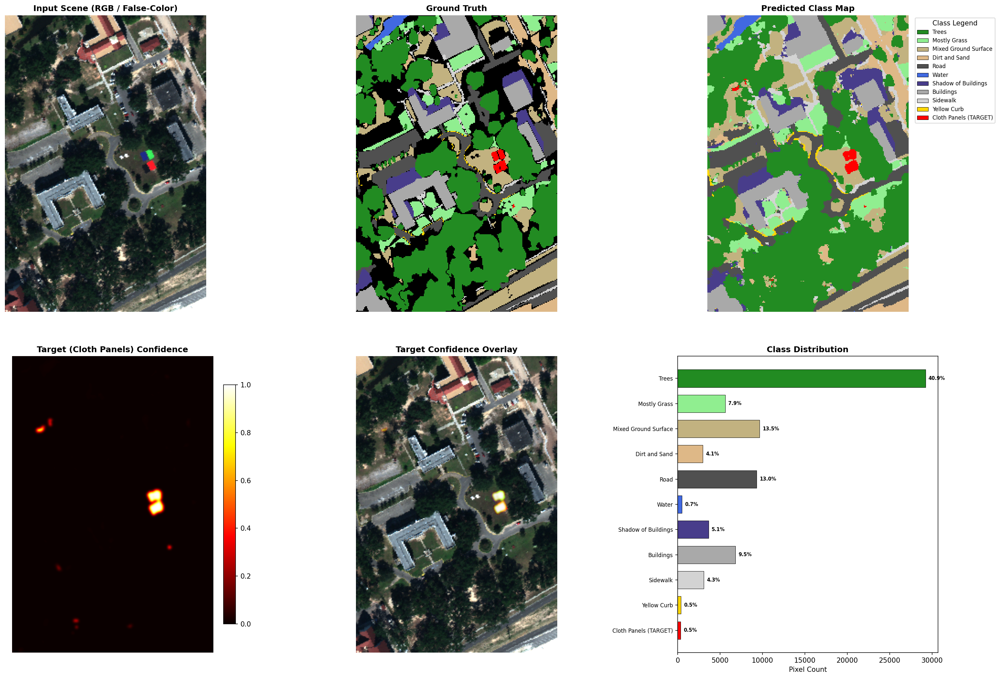

---

### ROC & Precision-Recall Operating Curves
Receiver Operating Characteristic (ROC) and Precision-Recall (PR) curves comparing the Fusion Model, Multi-Scale ACE, SAM, RX Anomaly, and Ensemble detector on held-out test pixels:

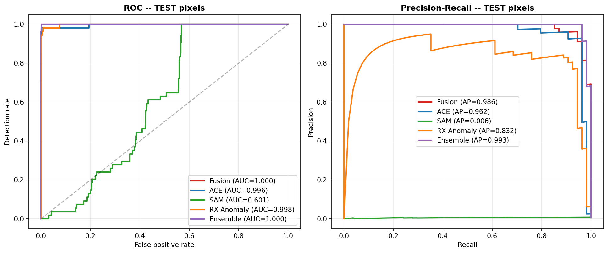

---

### Multi-Detector Spatial Heatmaps
Spatial detection response maps comparing the raw RGB scene, Ground Truth target locations, Fusion model confidence, Multi-Scale ACE score, SAM similarity, RX anomaly score, and the fused Ensemble response:

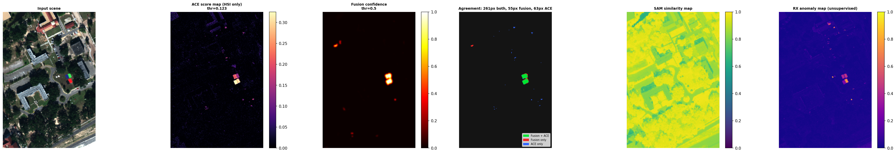

---

### Target Bounding Boxes & Scene Context
Full scene display with detected targets highlighted by color-coded bounding boxes and annotated with target IDs:

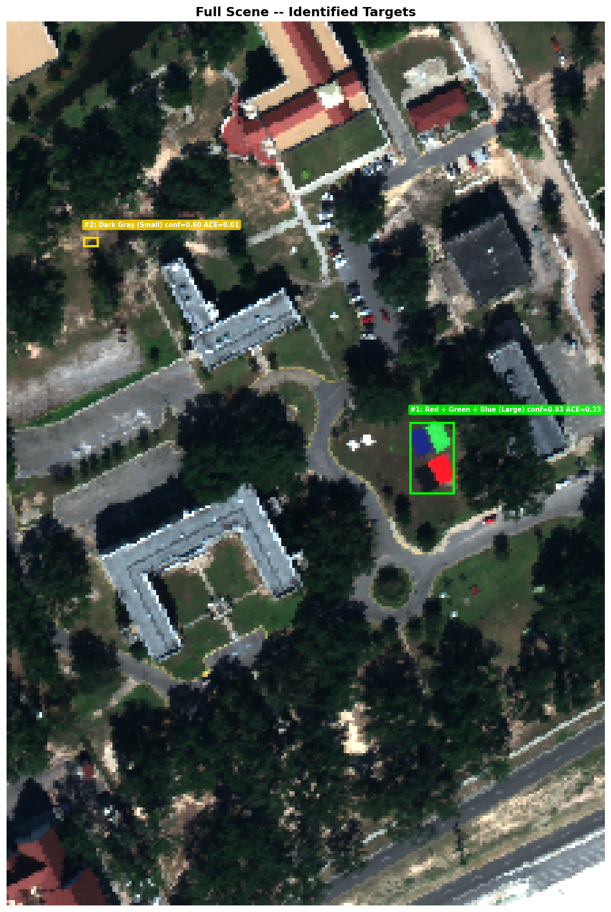

---

### Spectral Reflectance Signatures & Background Contrast
Target reflectance curves across all 72 spectral bands compared against training target references and immediate annular background surroundings:

| Target Spectral Signatures | Target vs. Background Contrast |
| :---: | :---: |
| 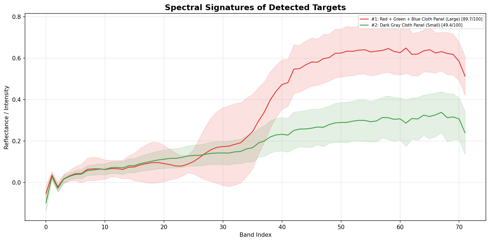 | 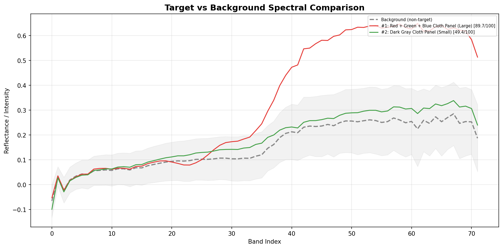 |

---

### 3D LiDAR Elevation & Roughness Cross-Sections
Cross-sectional LiDAR elevation profiles showing the 3D surface relief and height difference ($\Delta h$) of detected targets relative to the surrounding ground plane:

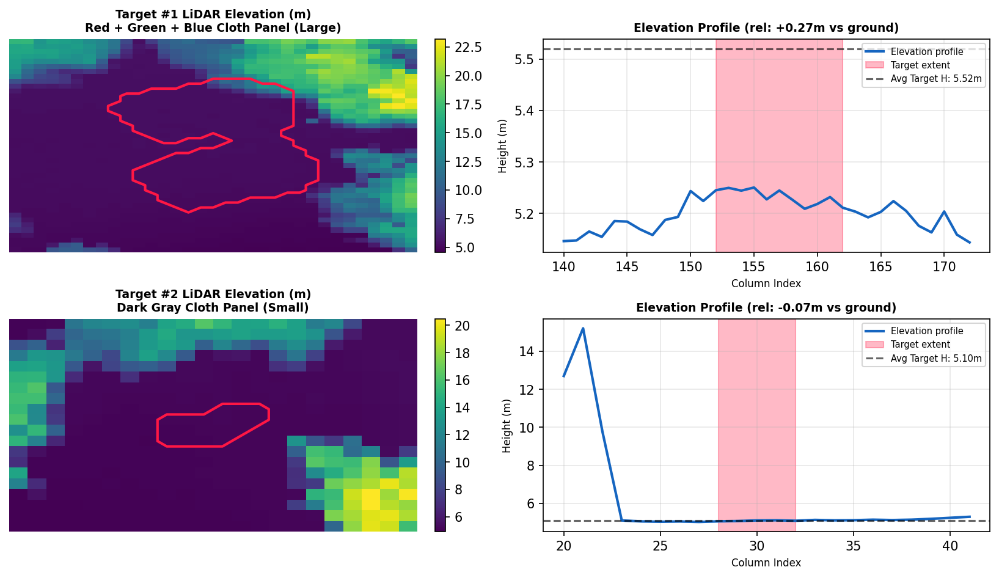

---

### Target Before/After Verification & Visual Crops
High-resolution zoom comparison showing the raw RGB image crop versus the overlaid target detection mask:

| High-Zoom Before / After Comparison | Individual Target Crops |
| :---: | :---: |
| 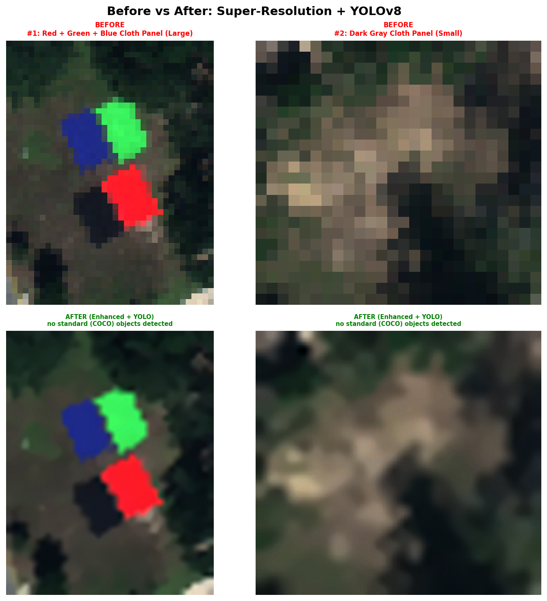 | 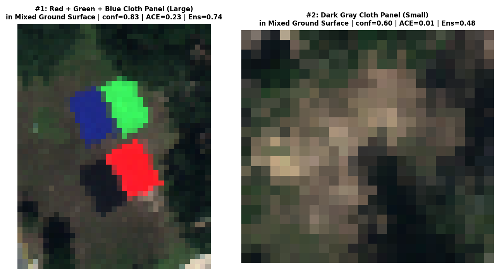 |

---

### YOLOv8-Enhanced Detection Visualizations
High-confidence target detections annotated with YOLOv8 bounding boxes, confidence badges, dominant color classifications, and context labels:

| Target #1 Enhanced (Quality: 89.7/100) | Target #2 Enhanced (Quality: 49.4/100) |
| :---: | :---: |
| 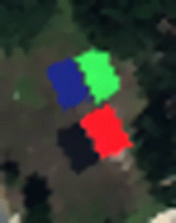 | 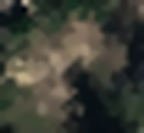 |

---

### Spectral Band Importance Attribution
Pearson correlation and mutual information between individual spectral bands (375 – 1055 nm) and target detection confidence, identifying key SWIR/NIR bands that break camouflage:

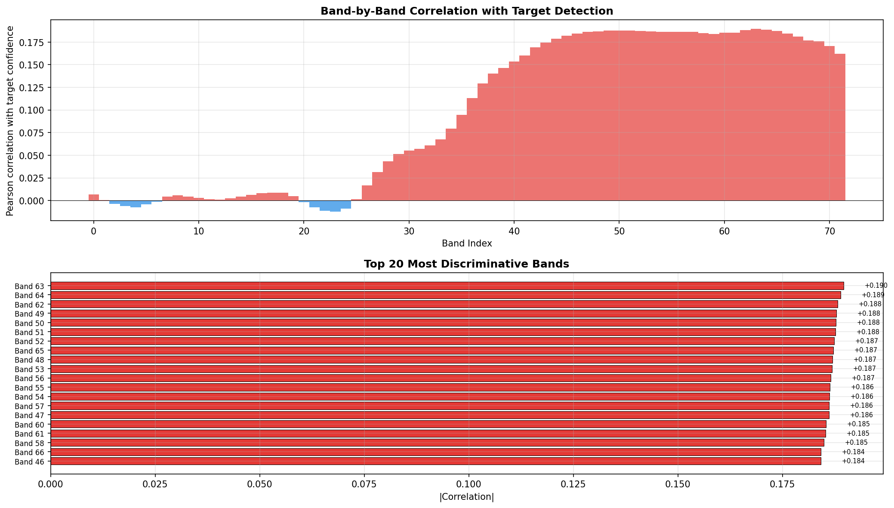

---

### Model Calibration & Reliability Diagrams
Empirical accuracy plotted against predicted confidence bins, demonstrating low Expected Calibration Error (ECE) and well-calibrated probabilistic output:

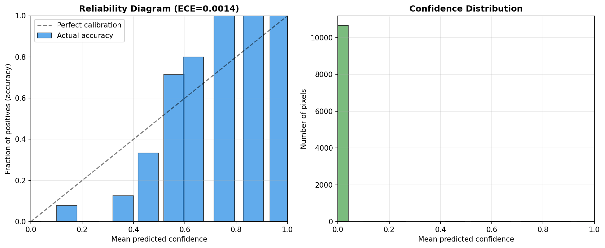

---

### Decision Threshold Sweeps
Precision, Recall, and F1-score across varying decision thresholds, displaying the Otsu-optimal operating point:

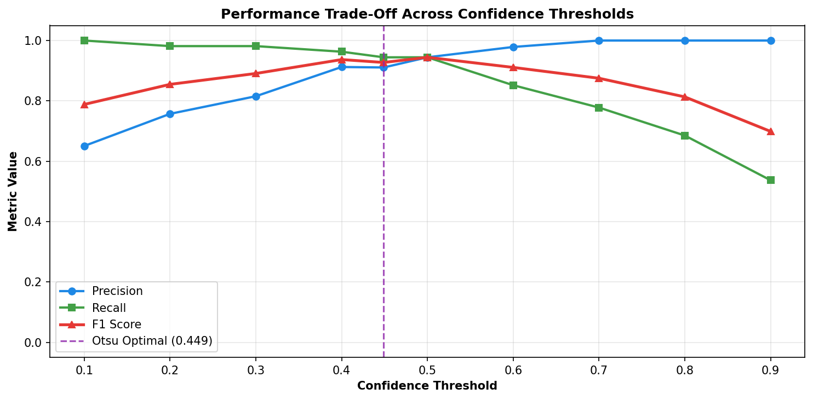

---

### Trento Dataset Visualizations
Cross-dataset benchmark results on the Trento scene:

| Trento Scene Classification | Trento ROC & PR Curves |
| :---: | :---: |
| 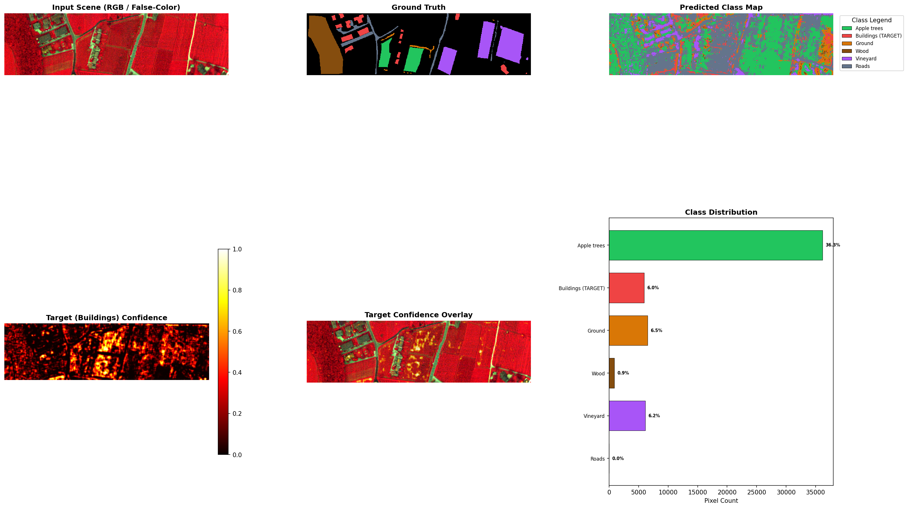 | 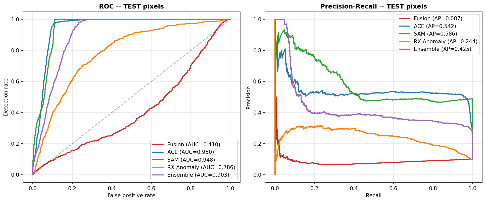 |

| Trento Spatial Heatmaps | Trento Confusion Matrix |
| :---: | :---: |
| 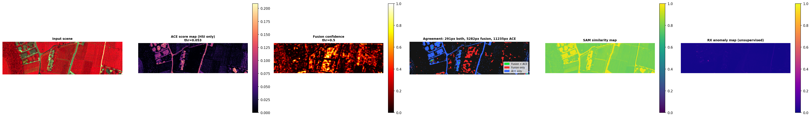 | 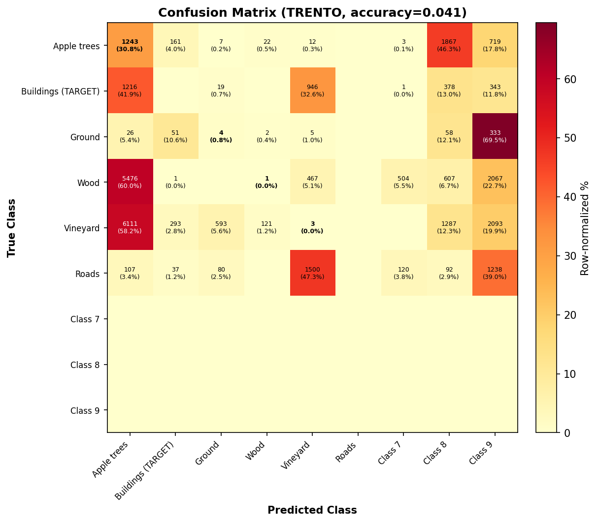 |

---

## Detailed Target Inspection Case Studies

The pipeline output for MUUFL Gulfport identified the candidate targets with the following characterization reports:

### Case Study: Target #1 (Large Camouflaged Cloth Panel)
- **Classification**: **Red + Green + Blue Cloth Panel (Large)**
- **Quality Score**: **89.7 / 100 — HIGH CONFIDENCE**
- **Location**: In Mixed Ground Surface area (64% of surroundings)
- **Centroid**: (Row 159.4, Col 156.5) | Bounding Box: `[147, 173, 148, 164]`
- **Size**: 298 pixels
- **Fusion Confidence**: Mean = **0.834**, Peak = **0.998**
- **Spectral Contrast Ratio**: **2.749**
- **3D LiDAR Elevation Profile**: 
  - Absolute Elevation: **5.52 m**
  - Relative Height vs. Ground: **+0.27 m**
  - Surface Roughness: **1.388 m**
- **Validation Check**:
  - ACE Detector: Mean = 0.234, Peak = 0.506 (Threshold = 0.123) $\rightarrow$ **CONFIRMED BY ACE**
  - SAM Detector: Mean = 0.948, Peak = 0.982
  - RX Anomaly: Mean = 0.341, Peak = 0.795 $\rightarrow$ **ANOMALOUS (CONFIRMED BY RX)**
  - Ensemble Score: **0.999**

### Case Study: Target #2 (Small Shadowed Panel)
- **Classification**: **Dark Gray Cloth Panel (Small)**
- **Quality Score**: **49.4 / 100 — LOW CONFIDENCE**
- **Location**: In Mixed Ground Surface area (56% of surroundings)
- **Centroid**: (Row 80.6, Col 30.4) | Bounding Box: `[79, 82, 28, 33]`
- **Size**: 18 pixels
- **Fusion Confidence**: Mean = **0.602**, Peak = **0.715**
- **Spectral Contrast Ratio**: **0.319**
- **3D LiDAR Elevation Profile**: Elevation = 5.10 m, Relative Height = -0.07 m
- **Validation Check**: Detected by fusion model; below threshold for classical ACE, correctly flagging it as requiring human analyst review.

---

## Repository Structure

```
.
├── assets/                               # Visual assets and output figures for documentation
│   ├── Electronic_Pipeline_Architecture.png
│   ├── chemistry_overview.png
│   ├── muufl/                            # MUUFL Gulfport benchmark visualizations
│   │   ├── ace_vs_fusion_curves.png
│   │   ├── ace_vs_fusion_maps.png
│   │   ├── band_importance.png
│   │   ├── calibration_diagram.png
│   │   ├── confusion_matrix.png
│   │   ├── detection_visualization.png
│   │   ├── full_scene_boxes.png
│   │   ├── spectral_signatures.png
│   │   ├── spectral_target_vs_background.png
│   │   ├── target_1_enhanced.png
│   │   ├── target_2_enhanced.png
│   │   ├── target_before_after.png
│   │   ├── target_crops.png
│   │   ├── target_lidar_profiles.png
│   │   └── threshold_sweep.png
│   └── trento/                           # Trento benchmark visualizations
│       ├── ace_vs_fusion_curves.png
│       ├── ace_vs_fusion_maps.png
│       ├── band_importance.png
│       ├── calibration_diagram.png
│       ├── confusion_matrix.png
│       ├── detection_visualization.png
│       ├── full_scene_boxes.png
│       └── threshold_sweep.png
├── detection_output/                     # Representative pipeline detection runs & logs
│   ├── targets/
│   │   ├── targets_report.csv
│   │   ├── targets_report.json
│   │   └── targets_report.txt
│   ├── classification_report.txt
│   ├── confusion_matrix.png
│   └── detection_visualization.png
├── OUTPUT/                               # Output directory for newly generated experiment runs
├── download.py                           # Automated downloader for HSIMAE and Utonia from Hugging Face
├── Fetch_houston.py                      # Automatic fetch utility for Houston 2013 dataset
├── finetune_fusion.py                    # Stage 3: Cross-Modal Attention Fusion model training
├── finetune_hsi.py                       # Stage 1: HSIMAE / HSIViT unimodal hyperspectral training
├── finetune_hsi2.py                      # Stage 1 (Variant 2): Alternative hyperspectral training setup
├── finetune_lidar.py                     # Stage 2: PointTransformerV3 / Utonia unimodal LiDAR training
├── full_pipeline.py                      # Main entrypoint alias (runs full_pipline.py)
├── full_pipline.py                       # Complete 9-stage integrated inference, evaluation & reporting script
├── Identify_targets.py                   # Standalone connected-component target identification module
├── identify_targetv2.py                  # Target identification v2 with enhanced profiling
├── Inference_pipeline.py                 # Pure full-scene model inference pipeline
├── inference_pipelineV2.py               # Enhanced inference pipeline v2 with TTA & mixed-precision
├── lidar_env.py                          # LiDAR point cloud geometry and coordinate utilities
├── preprocess.py                         # GWPCA reduction, spatial alignment, and patch extraction
├── requirements.txt                      # Python environment dependencies
├── test_hsi.py                           # Test evaluation script for trained HSI unimodal checkpoint
├── test_lidar.py                         # Test evaluation script for trained LiDAR unimodal checkpoint
├── .gitignore                            # Optimized gitignore hiding multi-GB datasets & checkpoints
├── .gitattributes                       # Git attributes for text line normalization
└── README.md                             # Comprehensive project documentation
```

---

## Setup & Installation Guide

### 1. Clone Repository & Setup Python Environment

```bash
# Clone the repository
git clone https://github.com/theswarajj/Deep-Learning-Based-HSI-LiDAR-Fusion-for-Camouflaged-Target-Detection.git
cd "Deep-Learning-Based-HSI-LiDAR-Fusion-for-Camouflaged-Target-Detection"

# Create and activate conda or venv environment (Python 3.10 recommended)
conda create -n hsi_lidar python=3.10 -y
conda activate hsi_lidar

# Install PyTorch with your CUDA version (e.g. CUDA 12.4)
pip install torch torchvision --index-url https://download.pytorch.org/whl/cu124

# Install all project dependencies
pip install -r requirements.txt
```

### 2. Download Pretrained Foundation Models
I created an automated download script [`download.py`](file:///c:/Users/swrjk/OneDrive/Desktop/NASIM11/Deep%20Learning-Based%20HSI–LiDAR%20Fusion%20for%20Camouflaged%20Target%20Detection/download.py) that fetches the foundation models directly from Hugging Face:

```bash
python download.py
```
This fetches:
- **HSIMAE** from `RyanWy/HSIMAE` (Hyperspectral Masked Autoencoder)
- **Utonia / PTv3** from `Pointcept/Utonia` (PointTransformerV3 for 3D LiDAR)

### 3. Running the Complete Pipeline
To run the full end-to-end inference, ACE/SAM/RX baseline evaluation, target characterization, and HTML report generation:

```bash
# Standard run (interactive prompt for MUUFL, Trento, or custom)
python full_pipeline.py

# Explicit run on MUUFL Gulfport
python full_pipeline.py --dataset muffl

# Explicit run on Trento benchmark
python full_pipeline.py --dataset trento

# Re-use an existing model pass and run rapid analytics/reporting
python full_pipeline.py --reuse_run "OUTPUT/run_20261017_225008"
```

### 4. GitHub Desktop & Large File Management
This repository is pre-configured with a `.gitignore` that safely hides:
- Multi-gigabyte raw datasets (`*.mat`, `*.npy`, `*.npz`, `houston_full/`, `MUUFLGulfport-master/`, `Trento-main/`)
- Multi-gigabyte model checkpoints (`*.pt`, `*.pth`, `*.pkl`, `runs/`, `pretrained_models/`)
- Temporary cache files (`__pycache__/`, `.pytest_cache/`)

**All output evaluation figures, confusion matrices, ROC curves, CSV/JSON reports, and scripts are preserved and tracked.**

To push via **GitHub Desktop**:
1. Open **GitHub Desktop**.
2. Select **File $\rightarrow$ Add Local Repository...** and choose this project folder.
3. Review the staged files — you will see that only source code, configs, reports, and asset images are staged (~15 MB total).
4. Enter a commit message (e.g., `Complete HSI-LiDAR fusion pipeline with full evaluation suite and test figures`).
5. Click **Commit to main** and then click **Publish repository**.

---

## CLI Reference

`full_pipeline.py` provides extensive command-line flexibility:

| Argument | Type | Default | Description |
| :--- | :---: | :---: | :--- |
| `--dataset` | `str` | `interactive` | Dataset selector: `interactive`, `muufl`, `trento`, or `custom` |
| `--data` | `str` | *MUUFL path* | Path to primary input scene `.mat` file |
| `--hsi_file` | `str` | `None` | Path to custom HSI `.mat` cube |
| `--lidar_file` | `str` | `None` | Path to custom LiDAR `.mat` DSM |
| `--labels` | `str` | `None` | Path to ground truth label `.mat` file |
| `--tta` | `bool` | `True` | Enable Test-Time Augmentation (flips + rotations) |
| `--mixed_precision` | `bool` | `True` | Enable FP16 mixed precision for ~2x GPU speedup |
| `--spatial_smooth_sigma` | `float` | `1.0` | Gaussian smoothing sigma for spatial confidence map |
| `--confidence_threshold` | `float` | `0.5` | Minimum confidence for target extraction |
| `--adaptive_threshold` | `bool` | `True` | Compute and display Otsu-optimal threshold |
| `--merge_radius` | `int` | `8` | Merge target fragments within this pixel radius |
| `--yolo` | `bool` | `True` | Generate YOLOv8 visual enhancement panels |
| `--ace` | `bool` | `True` | Compute classical Adaptive Coherence/Cosine Estimator |
| `--ace_multiscale` | `bool` | `True` | Multi-scale covariance shrinkage ensemble for ACE |
| `--sam` | `bool` | `True` | Compute Spectral Angle Mapper baseline |
| `--rx` | `bool` | `True` | Compute Reed-Xiaoli unsupervised anomaly detector |
| `--ensemble` | `bool` | `True` | Compute weighted multi-detector ensemble |
| `--ensemble_weights` | `float x3` | `0.5 0.3 0.2` | Weights for `[Fusion, ACE, SAM]` |
| `--threshold_sweep` | `bool` | `True` | Sweep decision thresholds and plot PR curves |
| `--lidar_profiles` | `bool` | `True` | Generate 3D cross-sectional LiDAR elevation profiles |
| `--html_report` | `bool` | `True` | Generate standalone HTML executive report |
| `--band_importance` | `bool` | `True` | Plot band-by-band target correlation |
| `--reuse_run` | `str` | `None` | Reuse existing `class_map.npy` / `target_confidence_map.npy` |

---

---

## Author & Acknowledgments

### Project Lead & Engineering
- **Developer**: Swaraj Krishna P P
- **Profile**: AI / ML Enthusiast & Computer Science and Engineering Graduate (Class of 2026)
- **Institution**: APJ Abdul Kalam Technological University (KTU)
- **Contact**: swrjkrishna@gmail.com
- **GitHub**: https://github.com/theswarajj

> **Attribution Note**:
> All conceptualization, architecture design, neural network modeling, and end-to-end engineering for this project were executed by Swaraj Krishna P P.

## Citation & References

If you build upon this work or use the pipeline in your research, please cite:

```bibtex
@article{hsi_lidar_camouflaged_fusion,
  title={Deep Learning-Based HSI–LiDAR Fusion for Camouflaged Target Detection},
  author={Swaraj Krishna P P},
  year={2026},
  journal={GitHub Repository},
  url={https://github.com/theswarajj/Deep-Learning-Based-HSI-LiDAR-Fusion-for-Camouflaged-Target-Detection}
}
```

### Key References:
1. **MUUFL Gulfport Dataset**: Gader, P., et al. *"MUUFL Gulfport Hyperspectral and LiDAR Airborne Data Set."* University of Florida (2013).
2. **Trento Dataset**: Dalponte, M., et al. *"Hybrid multicomponent classification of airborne hyperspectral and LiDAR data in forestry."* Remote Sensing of Environment (2012).
3. **HSIMAE**: Wang, Y., et al. *"Masked Autoencoders for Hyperspectral Image Classification."* IEEE TGRS (2024).
4. **PointTransformerV3 / Utonia**: Wu, X., et al. *"Point Transformer V3: Simpler, Faster, Stronger."* CVPR (2024).
5. **ACE Algorithm**: Kraut, S., & Scharf, L. L. *"The CFAR adaptive subspace detector is a scale-invariant GLRT."* IEEE TSP (2001).
6. **Reed-Xiaoli (RX)**: Reed, I. S., & Yu, X. *"Adaptive multiple-band CFAR detection of an optical array with unknown background noise."* IEEE TSP (1990).
